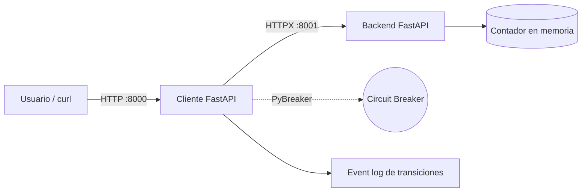
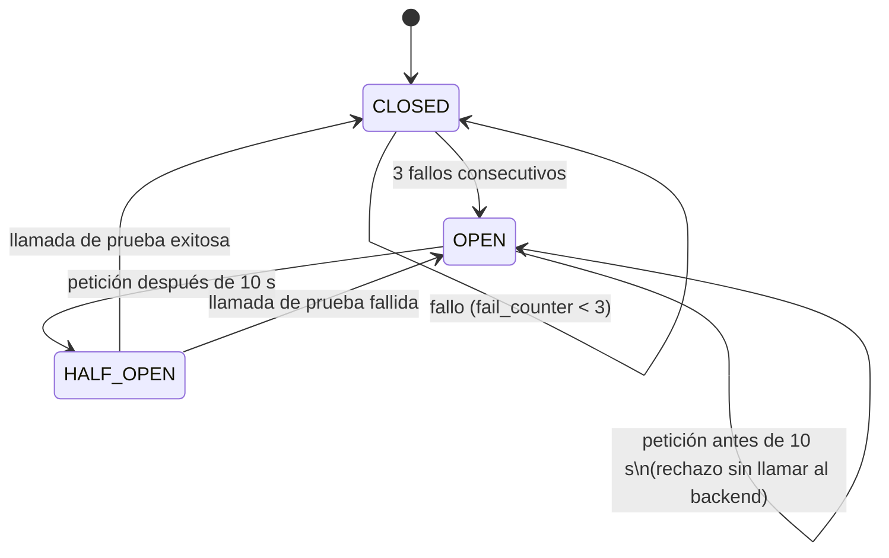
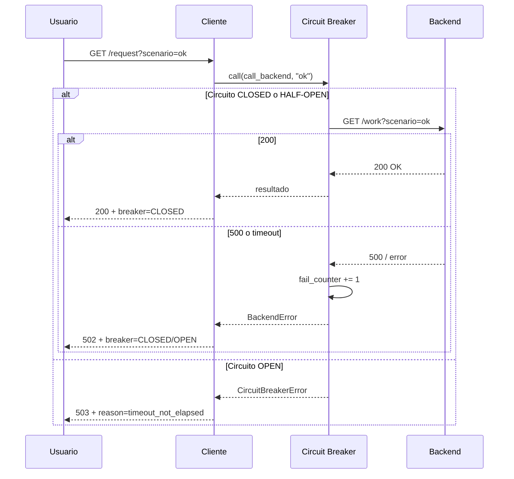
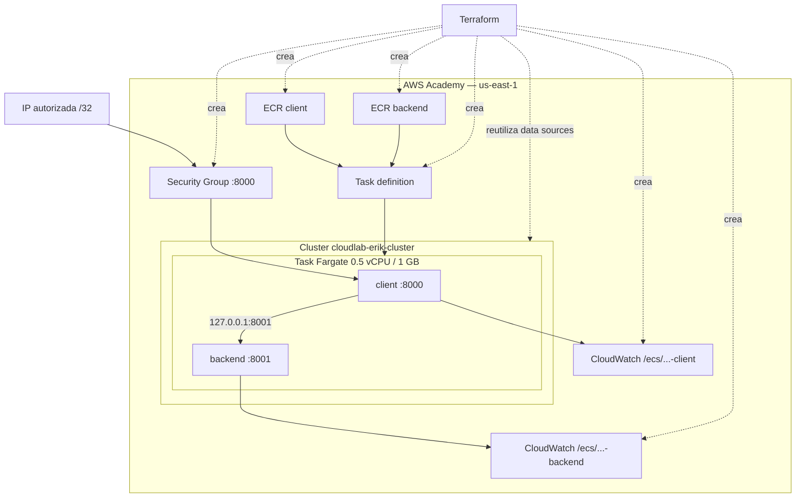

# Arquitectura del Laboratorio 01 — Circuit Breaker

## Vista general

La solución tiene dos microservicios FastAPI. El **cliente** es el único
expuesto al usuario y envuelve cada llamada al **backend** con un Circuit
Breaker de PyBreaker. El backend simula una dependencia que puede fallar.

En Docker Compose los servicios se comunican por la red `lab01` con el nombre
`backend`. En AWS ambos contenedores comparten la red de la tarea Fargate y el
cliente usa `http://127.0.0.1:8001`.

## Máquina de estados

Parámetros:

| Parámetro | Valor | Implementación |
|---|---|---|
| `fail_max` | 3 | `pybreaker.CircuitBreaker(fail_max=3, ...)` |
| `reset_timeout` | 10 s | Temporizador de PyBreaker basado en `datetime.now(UTC)`. |
| `success_threshold` | 1 | Un éxito en `HALF-OPEN` cierra el circuito. |
| Timeout HTTP | 2 s | `httpx.Client(timeout=2.0)`. |

PyBreaker no ejecuta un temporizador en segundo plano: el paso de `OPEN` a
`HALF-OPEN` ocurre cuando llega una petición después del `reset_timeout`. Por
eso la demo espera 11 segundos antes de la llamada de recuperación.

## Flujo de una petición

Puntos clave:

- El backend se invoca **solo** si el breaker lo permite. Mientras está `OPEN`,
  el cliente responde `503` sin abrir una conexión HTTP.
- Un `500` del backend se convierte en `BackendError`, que PyBreaker contabiliza
  como fallo.
- La llamada que alcanza el tercer fallo devuelve `503` con
  `reason=threshold_reached`; las siguientes devuelven `503` con
  `reason=timeout_not_elapsed`.
- El listener `TransitionListener` guarda cada cambio de estado con timestamp y
  `fail_counter`; se expone en `/breaker/status` y se registra en los logs.

## Componentes

| Componente | Responsabilidad |
|---|---|
| `client/main.py` | API pública, llamada HTTPX y traducción de errores a `502`/`503`. |
| `client/breaker.py` | Instancia única de PyBreaker, parámetros y listener de transiciones. |
| `backend/main.py` | Respuestas controladas `200`/`500` y contador de peticiones. |
| `compose.yaml` | Red interna y publicación del cliente en `127.0.0.1:8091`. |
| `scripts/demo.sh` | Secuencia reproducible con aserciones de estado y de contador. |
| Terraform | ECR, Security Group, task definition, servicio ECS y log groups. |

## Despliegue en AWS

Decisiones de infraestructura:

- **Estado Terraform independiente:** evita que un `destroy` afecte a los
  laboratorios 04, 05 o 07.
- **Data sources para recursos compartidos:** VPC, subredes, cluster y
  `LabRole` se consultan, no se administran.
- **Una sola tarea Fargate:** mantiene el estado del breaker en un único
  proceso y reduce el costo.
- **Dos contenedores en la misma tarea:** permite usar `localhost` y evita un
  ALB o Service Discovery.
- **IP pública temporal:** simplifica el acceso de demostración; el Security
  Group limita el puerto 8000 a una IPv4 `/32`.
- **CloudWatch Logs con retención de 3 días:** suficiente para las evidencias y
  de bajo costo.

## Alternativas descartadas

| Alternativa | Motivo para no usarla |
|---|---|
| Implementar la máquina de estados a mano | PyBreaker ya resuelve concurrencia, contadores y transiciones; el objetivo es demostrar el patrón, no reescribir la librería. |
| Varias réplicas del cliente | El estado en memoria se fragmentaría y la demo dejaría de ser determinista. |
| ALB o Service Discovery | Innecesarios para dos contenedores en la misma tarea; agregan costo y complejidad. |
| Reintentos automáticos | Corresponden al Laboratorio 02 y ocultarían el efecto del breaker. |
| Estado distribuido en Redis | Fuera del alcance de una práctica de una sola tarea; se documenta como limitación. |
