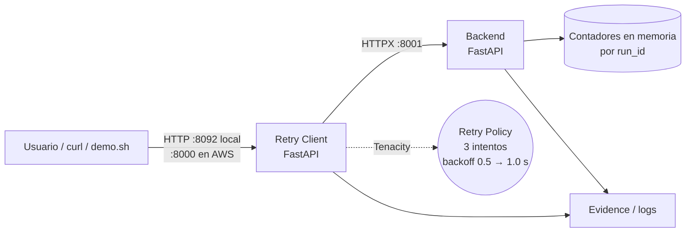
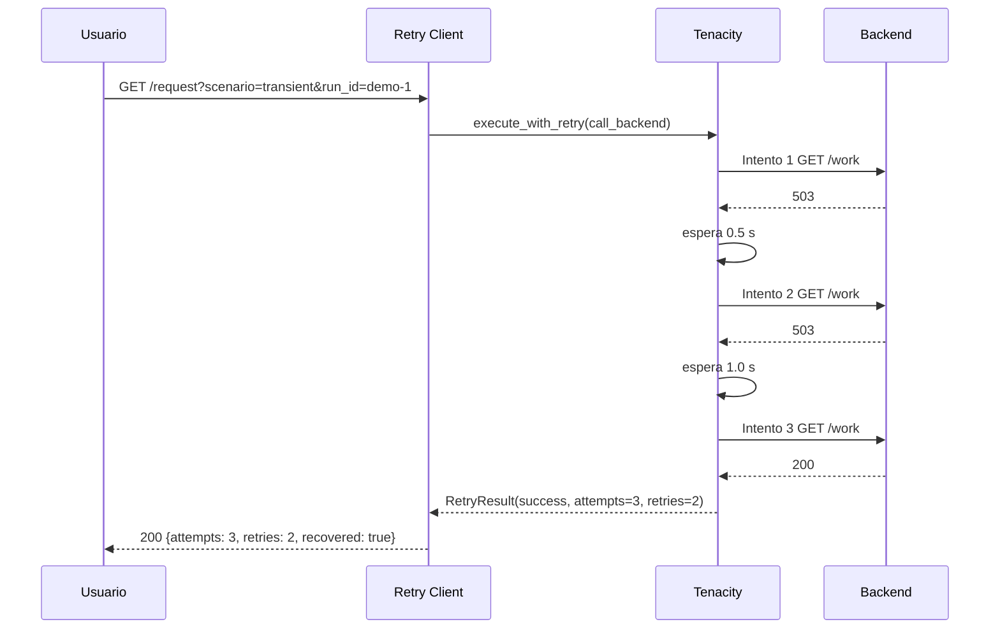
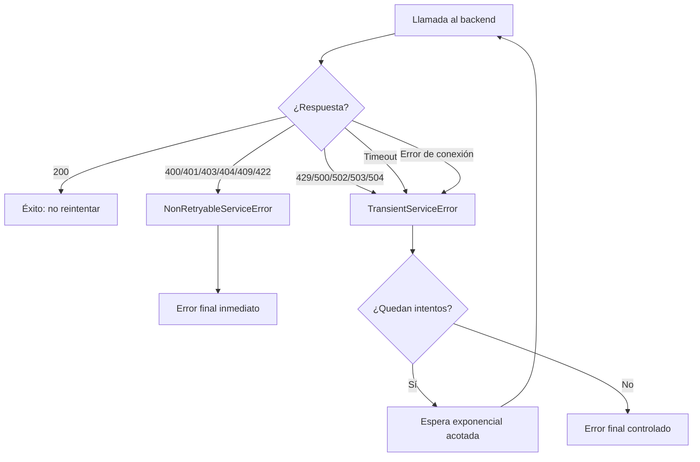
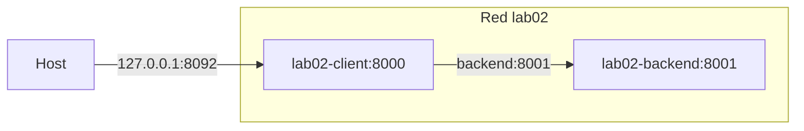
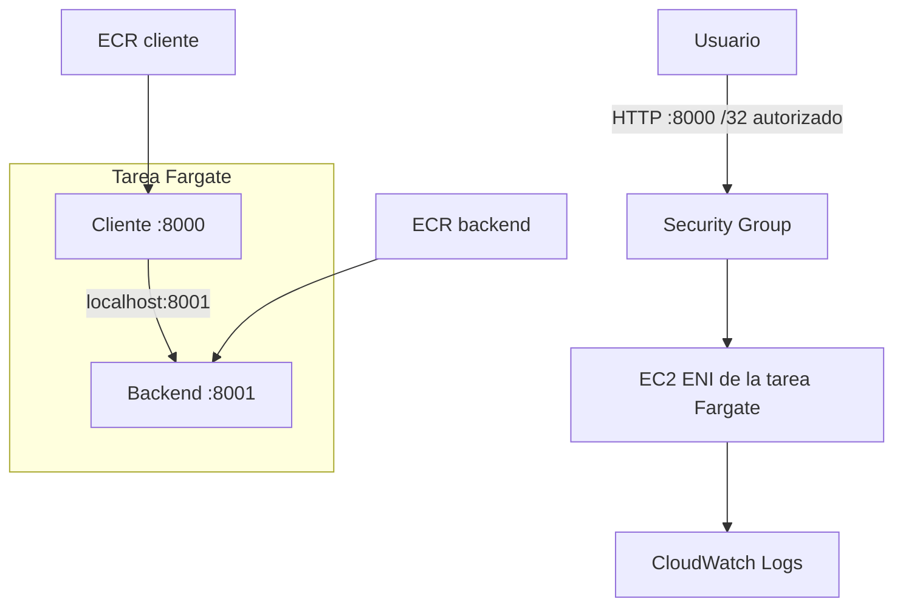

# Arquitectura del Laboratorio 02 — Retry Pattern

## Vista general

El sistema tiene dos microservicios FastAPI. El **cliente** es el único
expuesto al usuario y aplica la política de reintentos sobre cada llamada al
**backend**. El backend simula respuestas exitosas, fallos transitorios,
fallos permanentes, errores no reintentables y rate limiting.



En Docker Compose los servicios se comunican por la red `lab02` con el nombre
`backend`. En AWS ambos contenedores comparten la red `awsvpc` de la tarea
Fargate y el cliente usa `http://127.0.0.1:8001`.

## Componentes

| Componente | Responsabilidad |
|---|---|
| Retry Client | Expone `/request`, clasifica errores y aplica Tenacity |
| Retry Backend | Simula escenarios y mantiene contadores por `run_id` |
| `retry_policy.py` | Excepciones, política, backoff, jitter y registro de intentos |
| Docker Compose | Red privada, puertos y healthchecks locales |
| Terraform `ecr` | Dos repositorios de imágenes |
| Terraform `runtime` | Log groups, Security Group, Task Definition, Service y Cluster |
| CloudWatch | Logs de intentos, errores y recuperación |

## Flujo de una petición



El backend registra las tres solicitudes con el mismo `run_id`. La consulta
`GET /backend/stats?run_id=demo-1` devuelve `total_requests=3` y la secuencia
`[503, 503, 200]`.

## Política de reintentos



Parámetros:

| Parámetro | Valor | Implementación |
|---|---|---|
| `fail_max` / máximo de intentos | 3 | `stop_after_attempt(3)` |
| Reintentos adicionales | 2 | Derivado |
| Espera inicial | 0.5 s | `wait_exponential(multiplier=0.5, min=0.5, max=2)` |
| Segunda espera | 1.0 s | Backoff exponencial |
| Espera máxima | 2.0 s | `max=2` |
| Timeout HTTP | 2.0 s | `httpx.Client(timeout=2.0)` |
| Clasificación | Explícita | `retry_if_exception_type(TransientServiceError)` |
| Jitter | Opcional | `JitteredExponentialWait` con límites |

### Clasificación de errores

| Error | ¿Reintentar? | Justificación |
|---|---|---|
| HTTP 200 | No | Operación exitosa |
| HTTP 400 | No | Solicitud incorrecta |
| HTTP 401 / 403 | No | Autorización o permisos |
| HTTP 404 / 409 / 422 | No | El reintento no corrige el problema |
| HTTP 429 | Sí, con límites | Limitación temporal |
| HTTP 500 | Sí, con límites | Posible fallo transitorio |
| HTTP 502 / 503 / 504 | Sí, con límites | Indisponibilidad temporal |
| Error de conexión | Sí, con límites | Puede ser transitorio |
| Timeout | Sí, con límites | La operación es GET idempotente |

### `Retry-After`

Cuando el backend responde HTTP 429 incluye `Retry-After: 1`. La clase
`RetryAfterAwareExponentialWait` toma el mayor valor entre el backoff
exponencial y `Retry-After`, y lo limita a `max_wait=2.0`. Así se respeta la
indicación del servidor sin permitir esperas arbitrariamente largas.

### Jitter

La política principal es determinista para que la evidencia muestre esperas
exactas de 0.5 s y 1.0 s. La clase `JitteredExponentialWait` permite añadir
jitter acotado y se prueba con valores aleatorios simulados. El resultado
siempre queda en `[initial, max_wait]`.

## Registro de intentos

Cada intento produce un registro con:

```json
{
  "attempt": 1,
  "outcome": "retryable_error",
  "http_status": 503,
  "elapsed": 0.0203,
  "timestamp": 1795395856.27,
  "error": "HTTP 503 del backend",
  "retry_after": null,
  "response_body": {"status": "error", "request_number": 1}
}
```

El cliente devuelve `attempts`, `retries`, `recovered`, `waits`,
`attempt_details` y `backend_response`. El backend devuelve `total_requests`,
`failed_requests`, `successful_requests` y la secuencia de intentos.

## Docker local



- El backend no publica puertos al host.
- El cliente publica solo `127.0.0.1:8092`.
- Los healthchecks usan Python y `urllib`, sin instalar `curl`.
- El cliente espera a que el backend esté `healthy` antes de iniciar.

## Despliegue en AWS



### Recursos

| Recurso | Cantidad | Estado |
|---|---|---|
| Repositorios ECR | 2 | Estado `terraform/ecr` |
| CloudWatch Log Groups | 2 | Estado `terraform/runtime` |
| Security Group | 1 | Estado `terraform/runtime` |
| ECS Task Definition | 1 | Estado `terraform/runtime` |
| ECS Service | 1 | Estado `terraform/runtime` |
| ECS Cluster | 1 | Estado `terraform/runtime`, porque no había uno reutilizable |
| Tarea Fargate | 1 | Creada por el servicio |

No se usa Application Load Balancer, API Gateway, Service Discovery ni base de
datos. La tarea tiene una sola réplica y se accede por su IP pública.

### Task Definition

- `network_mode = "awsvpc"`.
- `requires_compatibilities = ["FARGATE"]`.
- `cpu = 512`, `memory = 1024`.
- Dos contenedores: `backend` y `client`.
- Backend en `:8001`, cliente en `:8000`.
- `BACKEND_URL=http://127.0.0.1:8001`.
- `dependsOn` del cliente respecto al backend con condición `START`.
- Dos log groups con retención de 3 días.
- `LabRole` como execution role y task role.
- Healthchecks de ambos contenedores con Python.

### Red

- VPC por defecto `172.31.0.0/16` (reutilizada).
- Subredes públicas de la VPC por defecto (reutilizadas).
- `assign_public_ip = true`.
- Security Group con ingreso al puerto `8000` solo desde `allowed_cidr` /32.
- Egress abierto para descargar imágenes y escribir logs.

## Decisiones y alternativas

| Decisión | Motivo |
|---|---|
| Tenacity | Evita programar el bucle, el backoff y el límite de intentos |
| Clasificación explícita | No se reintentan errores que no se corrigen |
| GET idempotente | Reintentar es seguro en la demo |
| Dos estados Terraform | Evita dependencias de imágenes inexistentes |
| VPC por defecto | No había VPC propia reutilizable y no se justifica crearla |
| Clúster nuevo | No había clúster reutilizable |
| Sin ALB | Una sola tarea y una sola réplica |
| Jitter separado | La demo principal necesita esperas deterministas |

## Limitaciones

1. Los contadores del backend son en memoria y no se comparten entre tareas.
2. La demo usa una sola réplica; no se demuestra coordinación distribuida.
3. Reintentar operaciones con efectos secundarios requiere idempotencia.
4. El acceso por IP pública es adecuado para el laboratorio, no para
   producción.
5. El backoff determinista es intencional para la evidencia; en producción se
   recomienda jitter para evitar sincronización de clientes.
