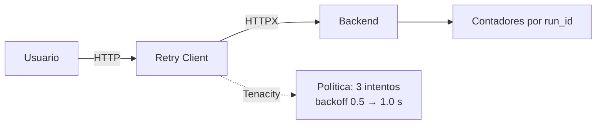

# Informe — Laboratorio 02: implementación del patrón Retry

## Pregunta de investigación

**¿Cómo se implementó el patrón Retry y qué demuestra la solución?**

## 1. Descripción de la solución

Se implementaron dos microservicios FastAPI:

- **Retry Client:** recibe la solicitud del usuario, llama al backend y aplica
  una política de reintentos con Tenacity. Devuelve un resumen con intentos,
  reintentos, esperas y resultado final.
- **Retry Backend:** simula respuestas HTTP 200, 400, 429 y 503. Mantiene
  contadores separados por `run_id` para que cada demostración sea
  independiente.

La solución demuestra cinco comportamientos:

1. Reintento automático ante fallos temporales.
2. Recuperación exitosa después de dos fallos HTTP 503.
3. Límite estricto de tres intentos.
4. Exponential Backoff con esperas de 0.5 s y 1.0 s.
5. Errores HTTP 400 que no se reintentan.

## 2. Arquitectura utilizada



En local, Docker Compose crea la red `lab02`; el cliente está en
`127.0.0.1:8092` y el backend solo es visible como `backend:8001`. En AWS, una
tarea Fargate ejecuta los dos contenedores con red `awsvpc`; el cliente usa
`http://127.0.0.1:8001` y el Security Group solo permite el puerto 8000 desde
la IP autorizada.

## 3. Implementación del mecanismo de reintentos

La lógica central está en `client/retry_policy.py`:

```python
policy = Retrying(
    stop=stop_after_attempt(3),
    wait=wait_exponential(multiplier=0.5, min=0.5, max=2),
    retry=retry_if_exception_type(TransientServiceError),
    reraise=True,
)
```

`call_backend()` en `client/main.py` traduce la respuesta HTTP a una excepción:

- `200` → respuesta exitosa.
- `400`, `401`, `403`, `404`, `409`, `422` → `NonRetryableServiceError`.
- `429`, `500`, `502`, `503`, `504` → `TransientServiceError`.
- Timeout o error de conexión → `TransientServiceError`.

Tenacity solo reintenta `TransientServiceError`. Cualquier otro error se
propaga de inmediato, por lo que HTTP 400 nunca genera un segundo intento.

Cada intento se registra con estado, código HTTP, duración, timestamp y
respuesta del backend. El cliente devuelve `attempts`, `retries`, `recovered`,
`waits` y `attempt_details`.

## 4. Configuración de intentos y tiempos de espera

| Parámetro | Valor |
|---|---|
| Máximo de intentos | 3 |
| Reintentos adicionales | 2 |
| Espera inicial | 0.5 s |
| Segunda espera | 1.0 s |
| Espera máxima | 2.0 s |
| Timeout HTTP por intento | 2.0 s |
| Estrategia | Exponential Backoff |
| Jitter | Opcional y acotado |

La espera se implementa con `wait_exponential(multiplier=0.5, min=0.5,
max=2)`. Para HTTP 429 se usa `RetryAfterAwareExponentialWait`, que respeta
`Retry-After` sin superar el máximo de 2 segundos.

## 5. Pruebas y evidencias obtenidas

La suite tiene **25 pruebas**:

- 11 pruebas de la política de reintentos.
- 10 pruebas de los endpoints del cliente.
- 4 pruebas de integración con un backend real en un hilo.

Los 10 escenarios del plan están cubiertos. Las pruebas de tiempo inyectan un
`sleep` falso, por lo que no dependen de esperas reales.

Evidencias principales:

| Evidencia | Resultado |
|---|---|
| `01-pytest.txt` | 25 passed |
| `02-docker-ps.txt` | Dos contenedores healthy |
| `03-normal-operation.txt` | 200 con 1 intento |
| `04-retry-recovery.txt` | 503, 503, 200; 3 intentos; recuperado |
| `05-retry-exhausted.txt` | 503, 503, 503; 3 intentos; error final |
| `06-no-retry-400.txt` | 400 con 1 intento; sin reintentos |
| `07-exponential-backoff.txt` | Esperas 0.5 s y 1.0 s; intervalos reales ~0.512 s y ~1.032 s |
| `08-backend-stats.txt` | Contadores del backend coinciden con los intentos |
| `09-terraform-validate.txt` | Configuración Terraform válida en ECR y runtime |
| `10-terraform-plan.txt` | 2 recursos ECR y 6 recursos runtime planificados |
| `11-terraform-apply.txt` | ECR, imágenes y runtime ECS creados; tarea `RUNNING`/`HEALTHY` |
| `12-ecs.png` / `12-ecs.txt` | Salida real de AWS CLI; PNG renderizado, no captura de consola |
| `13-aws-demo.txt` | Retry real contra Fargate con contadores del backend |
| `14-cloudwatch.txt` | Logs de intentos, recuperación y peticiones del backend |
| `15-terraform-destroy.txt` | 6 recursos runtime y 2 repositorios ECR destruidos |

La prueba de integración más importante verifica que el backend recibe
exactamente tres solicitudes, en orden `503, 503, 200`, y que el cliente
responde `attempts=3`, `retries=2`, `recovered=true`.

### Ejecución real en AWS

El despliegue se realizó el **2026-11-22** en `us-east-1`, cuenta
`533267299755`, reutilizando la VPC por defecto y `LabRole`. El servicio ECS
quedó `ACTIVE` con `1/1` tarea Fargate, y la tarea quedó `RUNNING` y
`HEALTHY` con los contenedores `client` y `backend`.

La demostración contra la IP pública `13.218.98.224` confirmó:

| Escenario | Resultado en AWS |
|---|---|
| `transient` | HTTP 200, 3 intentos, 2 reintentos, esperas `[0.5, 1.0]` |
| `permanent` | HTTP 503 tras 3 intentos, sin cuarto intento |
| `bad_request` | HTTP 400 con 1 intento |
| Contadores | `transient` registró `[503, 503, 200]`; `permanent`, `[503, 503, 503]` |

CloudWatch registró los intentos 1 y 2 como `retryable`, el intento 3 como
`success` y las peticiones del backend con `request=1`, `request=2` y
`request=3` para el mismo `run_id`. Después de guardar las evidencias se
destruyeron 6 recursos de runtime y 2 repositorios ECR; la verificación
posterior no encontró tareas, servicios activos, log groups, Security Groups
ni repositorios del laboratorio.

## 6. Resultados y conclusiones

La solución demuestra que Retry permite recuperarse de fallos temporales sin
intervención manual:

```text
Intento 1 → HTTP 503 → espera 0.5 s
Intento 2 → HTTP 503 → espera 1.0 s
Intento 3 → HTTP 200 → éxito
```

También demuestra que el patrón no debe aplicarse a ciegas:

- Con un fallo permanente, se detiene después de tres intentos y devuelve un
  error controlado.
- Con HTTP 400, no hay reintentos.
- Con HTTP 429, se respeta una espera acotada.
- El backend recibe exactamente el mismo número de solicitudes que los
  intentos del cliente.
- La misma política funcionó en Docker Compose y en una tarea ECS Fargate con
  los dos contenedores comunicados por `localhost`.

**Conclusión:** Retry mejora la disponibilidad percibida ante fallos
transitorios, pero debe combinarse con un límite de intentos, backoff y una
clasificación explícita de errores. Reintentar errores permanentes o
solicitudes no idempotentes puede aumentar la carga y duplicar efectos
secundarios. La ejecución en AWS confirmó el comportamiento observado en
local y la limpieza posterior confirmó que no quedaron recursos de prueba.

## 7. Enlace al repositorio

- Repositorio: <https://github.com/L4Ta-10001001/cloud-patterns-lab>
- Rama: `erik/practicas`
- Carpeta: `02-retry/`
- Documentación: `README.md`, `ARQUITECTURA.md`, `INFORME.md`
- Evidencias: `02-retry/evidencias/`

## Limitaciones

1. Los contadores del backend son en memoria y no sobreviven a reinicios.
2. La demo usa una sola réplica; no se demuestra coordinación entre nodos.
3. Reintentar operaciones con efectos secundarios requiere idempotencia.
4. El acceso por IP pública es adecuado para el laboratorio, no para
   producción.
5. La política principal es determinista para la evidencia; en producción se
   recomienda jitter para evitar retries sincronizados.
