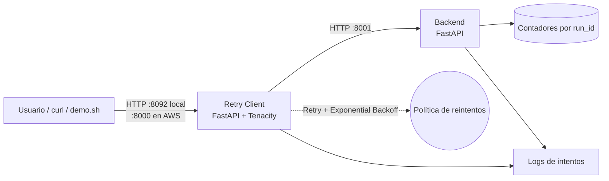

# Laboratorio 02 — Retry Pattern con FastAPI, Tenacity, Docker y AWS

## Objetivo

Implementar y demostrar el patrón **Retry** en un sistema distribuido de dos
microservicios. El cliente repite solicitudes fallidas de forma controlada,
con un máximo de intentos, espera exponencial y clasificación explícita de
errores. El backend simula fallos transitorios, fallos permanentes, errores
no reintentables y límites de solicitudes.

La demostración principal es una operación que falla dos veces con HTTP 503 y
responde HTTP 200 en el tercer intento. El backend registra exactamente tres
solicitudes y el cliente devuelve `attempts=3`, `retries=2` y
`recovered=true`.

## Integración y estado final

| Elemento | Valor |
|---|---|
| Rama de trabajo | `erik/practicas` |
| Implementación | Erik asumió el Laboratorio 02, asignado inicialmente a César |
| Flujo de integración | `erik/practicas` → [PR #11](https://github.com/L4Ta-10001001/cloud-patterns-lab/pull/11) → `main` |
| Estado local | ✅ Implementado y probado |
| Estado AWS | ✅ Desplegado en ECS Fargate, verificado y destruido |

> El laboratorio se desarrolló en una carpeta independiente (`02-retry/`) para
> no modificar los laboratorios 01, 03, 04, 05, 06, 07 ni 08.

## Arquitectura



En Docker Compose el cliente usa `http://backend:8001`. En AWS ambos
contenedores comparten la red de la tarea Fargate y el cliente usa
`http://127.0.0.1:8001`.

## Tecnologías

| Tecnología | Función |
|---|---|
| Python 3.12 | Lenguaje de los dos microservicios |
| FastAPI | API REST del cliente y del backend |
| Tenacity | Política de reintentos, límite de intentos y backoff |
| HTTPX | Comunicación HTTP con timeout por intento |
| Pytest | Pruebas unitarias y de integración |
| Docker Compose | Ejecución local con dos contenedores |
| Terraform | Infraestructura AWS en dos estados independientes |
| Amazon ECR | Repositorios de las dos imágenes |
| Amazon ECS Fargate | Ejecución de una tarea con dos contenedores |
| CloudWatch | Logs de intentos, errores y recuperación |
| GitHub | Código, documentación y revisión |

## Estructura

```text
02-retry/
├── client/
│   ├── main.py
│   ├── retry_policy.py
│   ├── requirements.txt
│   └── Dockerfile
├── backend/
│   ├── main.py
│   ├── requirements.txt
│   └── Dockerfile
├── tests/
│   ├── conftest.py
│   ├── test_retry.py
│   ├── test_client.py
│   └── test_integration.py
├── scripts/
│   ├── demo.sh
│   └── aws-demo.sh
├── terraform/
│   ├── ecr/
│   │   ├── main.tf
│   │   ├── variables.tf
│   │   ├── outputs.tf
│   │   └── versions.tf
│   └── runtime/
│       ├── main.tf
│       ├── variables.tf
│       ├── outputs.tf
│       ├── versions.tf
│       └── terraform.tfvars.example
├── evidencias/
│   └── README.md
├── compose.yaml
├── requirements-dev.txt
├── README.md
├── ARQUITECTURA.md
└── INFORME.md
```

## Ejecución local

### 1. Pruebas automatizadas

```bash
cd 02-retry
python3 -m venv .venv
source .venv/bin/activate
python -m pip install -r requirements-dev.txt
python -m pytest -v
```

Resultado real: **25 pruebas aprobadas** en `evidencias/01-pytest.txt`.

### 2. Contenedores

```bash
docker compose up --build -d
docker compose ps
curl http://127.0.0.1:8092/health
```

El cliente queda en `127.0.0.1:8092` y el backend solo es accesible dentro de
la red `lab02`, en `http://backend:8001`. La evidencia
`evidencias/02-docker-ps.txt` muestra ambos contenedores en estado `healthy`.

### 3. Demostración completa

```bash
bash scripts/demo.sh
```

El script espera a `/health`, ejecuta los escenarios y genera las evidencias
`03` a `08`. Al finalizar:

```bash
docker compose down
```

## Endpoints

### Cliente (`:8000` en el contenedor, `:8092` en local)

| Endpoint | Función |
|---|---|
| `GET /health` | Estado del cliente y configuración de la política |
| `GET /request?scenario=success` | Solicitud exitosa, sin reintentos |
| `GET /request?scenario=transient` | Falla dos veces y se recupera en el tercer intento |
| `GET /request?scenario=permanent` | Agota los tres intentos con HTTP 503 |
| `GET /request?scenario=bad_request` | HTTP 400 sin reintentos |
| `GET /request?scenario=rate_limit` | HTTP 429 con espera acotada y `Retry-After` |
| `GET /backend/stats?run_id=...` | Consulta los contadores del backend sin reintentos |

Todas las peticiones aceptan un `run_id` opcional. Si no se envía, el cliente
genera uno. El `run_id` aísla los contadores de cada demostración.

### Backend (`:8001`, solo red interna)

| Endpoint | Función |
|---|---|
| `GET /health` | Disponibilidad del backend |
| `GET /work?scenario=success` | HTTP 200 |
| `GET /work?scenario=transient` | HTTP 503 las dos primeras veces y HTTP 200 la tercera |
| `GET /work?scenario=permanent` | HTTP 503 siempre |
| `GET /work?scenario=bad_request` | HTTP 400 |
| `GET /work?scenario=rate_limit` | HTTP 429 con `Retry-After: 1` |
| `GET /stats?run_id=...` | Contadores y secuencia de estados por ejecución |

## Comportamiento del Retry

### Política

| Parámetro | Valor | Implementación |
|---|---|---|
| Máximo de intentos | 3 | `stop_after_attempt(3)` |
| Reintentos adicionales | 2 | Derivado de los intentos |
| Espera inicial | 0.5 s | `wait_exponential(multiplier=0.5, min=0.5, max=2)` |
| Segunda espera | 1.0 s | Backoff exponencial |
| Espera máxima | 2.0 s | `max=2` |
| Timeout HTTP por intento | 2.0 s | `httpx.Client(timeout=2.0)` |
| Estrategia | Exponential Backoff | Tenacity |
| Jitter | Opcional y acotado | `JitteredExponentialWait` probado aparte |
| Reintentos | Solo errores recuperables | `retry_if_exception_type(TransientServiceError)` |

### Clasificación de errores

| Respuesta | ¿Reintentar? | Tratamiento |
|---|---|---|
| HTTP 200 | No | Éxito inmediato |
| HTTP 400 | No | `NonRetryableServiceError` |
| HTTP 401 / 403 | No | `NonRetryableServiceError` |
| HTTP 404 / 409 / 422 | No | `NonRetryableServiceError` |
| HTTP 429 | Sí, con límite | `TransientServiceError` + `Retry-After` acotado |
| HTTP 500 | Sí, con límite | `TransientServiceError` |
| HTTP 502 / 503 / 504 | Sí, con límite | `TransientServiceError` |
| Error de conexión | Sí, con límite | `TransientServiceError` |
| Timeout | Sí, con límite | `TransientServiceError` |

Las operaciones son `GET` de solo lectura. Por eso reintentar timeouts es
seguro: no hay pagos ni escrituras no idempotentes en la demostración.

### Escenarios

| Escenario | Secuencia del backend | Resultado del cliente |
|---|---|---|
| `success` | 200 | 1 intento, 0 reintentos |
| `transient` | 503, 503, 200 | 3 intentos, 2 reintentos, recuperado |
| `permanent` | 503, 503, 503 | 3 intentos, error final 503 |
| `bad_request` | 400 | 1 intento, sin reintentos |
| `rate_limit` | 429, 429, 429 | 3 intentos, espera acotada, error final 429 |

### Formato de respuesta

```json
{
  "status": "success",
  "service": "retry-client",
  "run_id": "demo-...-transient",
  "scenario": "transient",
  "attempts": 3,
  "retries": 2,
  "recovered": true,
  "http_status": 200,
  "waits": [0.5, 1.0],
  "total_elapsed": 1.577,
  "attempt_details": [
    {"attempt": 1, "http_status": 503, "outcome": "retryable_error"},
    {"attempt": 2, "http_status": 503, "outcome": "retryable_error"},
    {"attempt": 3, "http_status": 200, "outcome": "success"}
  ],
  "backend_response": {"status": "ok", "request_number": 3},
  "error": null
}
```

## Pruebas automatizadas

La suite tiene **25 pruebas** y cubre los 10 escenarios solicitados, más
pruebas de cliente, integración, conexión, timeout, rate limiting y jitter.

| Grupo | Cantidad | Archivo |
|---|---|---|
| Política de reintentos | 11 | `tests/test_retry.py` |
| Endpoints del cliente | 10 | `tests/test_client.py` |
| Integración real cliente-backend | 4 | `tests/test_integration.py` |
| **Total** | **25** | |

Los 10 escenarios del plan están cubiertos:

| N.º | Escenario | Prueba |
|---|---|---|
| 01 | Backend responde correctamente | `test_01_success_on_first_attempt` |
| 02 | Falla una vez y se recupera | `test_02_one_failure_then_success` |
| 03 | Falla dos veces y se recupera | `test_03_two_failures_then_success` |
| 04 | Falla permanentemente | `test_04_permanent_failure_stops_after_three_attempts` |
| 05 | HTTP 400 no se reintenta | `test_05_bad_request_is_not_retried` |
| 06 | HTTP 503 se reintenta | `test_06_503_triggers_retries` |
| 07 | No existe un cuarto intento | `test_07_no_fourth_attempt` |
| 08 | Exponential Backoff | `test_08_exponential_backoff_waits` |
| 09 | HTTP 429 con espera limitada | `test_09_rate_limit_honors_retry_after_with_cap` |
| 10 | Contadores del backend | `test_integration_transient_recovers_with_three_backend_requests` |

Las pruebas de tiempo usan un `sleep` inyectado, por lo que la suite no espera
0.5 ni 1.0 segundos reales. La prueba de integración levanta un backend real
en un hilo y verifica que el backend recibe exactamente tres solicitudes, en
orden `503, 503, 200`.

## Despliegue en AWS con Terraform

Terraform está separado en dos estados para evitar que el runtime dependa de
imágenes que todavía no existen.

### Requisitos

- Credenciales temporales de AWS Academy vigentes.
- `LabRole` disponible.
- Terraform >= 1.5 y AWS provider ~> 6.0.
- Docker con capacidad para construir imágenes `linux/amd64`.

### Fase 1: repositorios ECR

```bash
cd terraform/ecr
terraform init
terraform validate
terraform plan -out=tfplan
terraform apply tfplan
```

Crea **2 repositorios ECR**:
`cloudlab-erik-retry-client` y `cloudlab-erik-retry-backend`.

### Fase 2: construir y publicar imágenes

```bash
cd ../..
ACCOUNT_ID="$(aws sts get-caller-identity --query Account --output text)"
REGION="us-east-1"
REGISTRY="$ACCOUNT_ID.dkr.ecr.$REGION.amazonaws.com"

docker build --platform linux/amd64 -t cloudlab-erik-retry-client:v1 ./client
docker build --platform linux/amd64 -t cloudlab-erik-retry-backend:v1 ./backend

aws ecr get-login-password --region "$REGION" \
  | docker login --username AWS --password-stdin "$REGISTRY"

docker tag cloudlab-erik-retry-client:v1 "$REGISTRY/cloudlab-erik-retry-client:v1"
docker tag cloudlab-erik-retry-backend:v1 "$REGISTRY/cloudlab-erik-retry-backend:v1"
docker push "$REGISTRY/cloudlab-erik-retry-client:v1"
docker push "$REGISTRY/cloudlab-erik-retry-backend:v1"
```

### Fase 3: runtime ECS Fargate

```bash
cd terraform/runtime
terraform init
terraform validate
terraform plan \
  -var="allowed_cidr=$(curl -4 -s https://checkip.amazonaws.com)/32" \
  -out=tfplan
terraform apply tfplan
```

La configuración reutiliza la VPC por defecto y sus subredes públicas. Si
existe una VPC o un clúster propio, se pueden pasar `vpc_id`, `subnet_ids` y
`ecs_cluster_name`. Como no había un clúster reutilizable, se crea uno nuevo.

Recursos del estado `runtime`:

| Recurso | Cantidad |
|---|---|
| Repositorios ECR | 2, en el estado `ecr` |
| CloudWatch Log Groups | 2 |
| Security Group | 1 |
| ECS Task Definition | 1 |
| ECS Service | 1 |
| ECS Cluster | 1, porque no había uno reutilizable |
| Tarea Fargate | 1, creada por el servicio |
| **Total Terraform** | **8** (2 ECR + 6 runtime) |

No se usa ALB, API Gateway, Service Discovery ni base de datos. El cliente y
el backend comparten la red `awsvpc` de la tarea y se comunican por
`localhost:8001`.

### Fase 4: validar y ejecutar la demo

```bash
CLUSTER="cloudlab-erik-retry-cluster"
SERVICE="cloudlab-erik-retry-service"

aws ecs wait services-stable --cluster "$CLUSTER" --services "$SERVICE"

TASK_ARN="$(aws ecs list-tasks --cluster "$CLUSTER" --service-name "$SERVICE" \
  --query 'taskArns[0]' --output text)"
ENI="$(aws ecs describe-tasks --cluster "$CLUSTER" --tasks "$TASK_ARN" \
  --query 'tasks[0].attachments[0].details[?name==`networkInterfaceId`].value' \
  --output text)"
PUBLIC_IP="$(aws ec2 describe-network-interfaces --network-interface-ids "$ENI" \
  --query 'NetworkInterfaces[0].Association.PublicIp' --output text)"

curl "http://$PUBLIC_IP:8000/health"
BASE_URL="http://$PUBLIC_IP:8000" bash scripts/aws-demo.sh
```

`scripts/aws-demo.sh` descubre la tarea, ejecuta los mismos escenarios de
`demo.sh` y genera `13-aws-demo.txt` y `14-cloudwatch.txt`.

### Limpieza

```bash
cd terraform/runtime
terraform destroy -var="allowed_cidr=$(curl -4 -s https://checkip.amazonaws.com)/32"

cd ../ecr
terraform destroy
```

Primero se destruye el runtime y después los repositorios ECR, una vez
guardadas todas las evidencias. Los repositorios usan `force_delete = true`
para que Terraform pueda eliminarlos aunque contengan las imágenes publicadas.
La ejecución real destruyó **6 recursos de runtime y 2 repositorios ECR**; la
verificación posterior confirmó que no quedan tareas, servicios activos, log
groups, Security Groups ni repositorios del laboratorio.

## Resultados reales

### Ejecución local

| Escenario | HTTP final | Intentos | Reintentos | Backend | Evidencia |
|---|---|---|---|---|---|
| `success` | 200 | 1 | 0 | 1 solicitud | `03-normal-operation.txt` |
| `transient` | 200 | 3 | 2 | 3 solicitudes: 503, 503, 200 | `04-retry-recovery.txt` |
| `permanent` | 503 | 3 | 2 | 3 solicitudes: 503, 503, 503 | `05-retry-exhausted.txt` |
| `bad_request` | 400 | 1 | 0 | 1 solicitud: 400 | `06-no-retry-400.txt` |
| `transient` (backoff) | 200 | 3 | 2 | 3 solicitudes | `07-exponential-backoff.txt` |

La evidencia `07` muestra esperas configuradas `[0.5, 1.0]` e intervalos
reales de aproximadamente `0.512 s` y `1.032 s`.

### Ejecución en AWS

El despliegue real se ejecutó el **2026-11-22** en `us-east-1`, cuenta
`533267299755`, con la VPC por defecto y `LabRole`.

| Elemento | Resultado real | Evidencia |
|---|---|---|
| Servicio ECS | `ACTIVE`, Fargate, `1/1` tarea en ejecución | `11-terraform-apply.txt`, `12-ecs.txt` |
| Tarea Fargate | `RUNNING` y `HEALTHY`, 512 CPU / 1024 MiB | `12-ecs.txt`, `12-ecs.png` |
| Contenedores | `backend` y `client` en `RUNNING` / `HEALTHY` | `12-ecs.txt` |
| Red | IP pública `13.218.98.224`, subred `subnet-04dab9ed2b71261a0` | `12-ecs.txt` |
| `transient` en AWS | HTTP 200, 3 intentos, 2 reintentos, esperas `[0.5, 1.0]` | `13-aws-demo.txt` |
| `permanent` en AWS | HTTP 503 tras 3 intentos, sin cuarto intento | `13-aws-demo.txt` |
| `bad_request` en AWS | HTTP 400 con 1 solo intento | `13-aws-demo.txt` |
| CloudWatch | Intentos `retryable`, recuperación y peticiones del backend | `14-cloudwatch.txt` |
| Limpieza | 6 recursos runtime + 2 repositorios ECR destruidos | `15-terraform-destroy.txt` |

La evidencia `12-ecs.png` es un **renderizado de la salida real de AWS CLI**
guardada en `12-ecs.txt`; no se presenta como una captura de la consola web.
La demo en AWS reutilizó `scripts/demo.sh` sin cambiar la lógica de la
aplicación y verificó los contadores del backend para cada `run_id`.

## Criterios de aceptación

| # | Criterio | Evidencia | Estado |
|---|---|---|---|
| 1 | Rama de Git y estructura preparadas | `erik/practicas`, `02-retry/` | ✅ |
| 2 | Dos microservicios FastAPI funcionales | `client/main.py`, `backend/main.py` | ✅ |
| 3 | Retry implementado con Tenacity | `client/retry_policy.py` | ✅ |
| 4 | Recuperación tras fallos temporales | `04-retry-recovery.txt` | ✅ |
| 5 | Máximo de tres intentos respetado | `05-retry-exhausted.txt` | ✅ |
| 6 | HTTP 400 excluido de reintentos | `06-no-retry-400.txt` | ✅ |
| 7 | Exponential Backoff demostrado | `07-exponential-backoff.txt` | ✅ |
| 8 | Pruebas automatizadas aprobadas | `01-pytest.txt`, 25 passed | ✅ |
| 9 | Docker Compose y demo local funcionales | `02-docker-ps.txt`, `03`–`08` | ✅ |
| 10 | Terraform validado y recursos AWS desplegados | `09`, `10`, `11` | ✅ |
| 11 | Retry ejecutado y verificado en ECS Fargate | `12`, `13` | ✅ |
| 12 | Evidencias y documentación completas | `01`–`15`, README, ARQUITECTURA, INFORME | ✅ |
| 13 | Código integrado en GitHub | Commit y [PR #11](https://github.com/L4Ta-10001001/cloud-patterns-lab/pull/11) | ✅ |
| 14 | Recursos AWS de prueba eliminados | `15-terraform-destroy.txt` | ✅ |

## Evidencias

| N.º | Archivo | Contenido |
|---|---|---|
| 01 | `01-pytest.txt` | 25 pruebas aprobadas |
| 02 | `02-docker-ps.txt` | Dos contenedores healthy |
| 03 | `03-normal-operation.txt` | 200 con un intento |
| 04 | `04-retry-recovery.txt` | 503, 503, 200 y recuperación |
| 05 | `05-retry-exhausted.txt` | Tres intentos y 503 final |
| 06 | `06-no-retry-400.txt` | 400 con un intento |
| 07 | `07-exponential-backoff.txt` | Esperas 0.5 s y 1.0 s |
| 08 | `08-backend-stats.txt` | Contadores del backend por `run_id` |
| 09 | `09-terraform-validate.txt` | Validación de ambos estados |
| 10 | `10-terraform-plan.txt` | Planes de ECR y runtime |
| 11 | `11-terraform-apply.txt` | Aplicación de la infraestructura |
| 12 | `12-ecs.png` / `12-ecs.txt` | Renderizado y salida cruda de AWS CLI sobre la tarea ECS |
| 13 | `13-aws-demo.txt` | Demostración real contra Fargate |
| 14 | `14-cloudwatch.txt` | Logs de cliente y backend |
| 15 | `15-terraform-destroy.txt` | Destrucción de recursos |

## Limitaciones y decisiones

1. **Reintentar solo es seguro en operaciones idempotentes.** La demo usa
   `GET` de solo lectura. En operaciones con efectos secundarios se necesita
   una clave de idempotencia o una operación idempotente.
2. **El backend guarda contadores en memoria.** Es suficiente para una tarea
   con una réplica, pero no sobrevive a reinicios ni se comparte entre tareas.
3. **No se usa Circuit Breaker ni Timeout Pattern.** El laboratorio 01 ya
   demuestra Circuit Breaker y el laboratorio 03 demuestra Timeout. Aquí solo
   se usa un timeout HTTP de seguridad por intento.
4. **No hay ALB ni Service Discovery.** La tarea tiene una sola réplica y se
   accede por su IP pública, igual que en el laboratorio 01.
5. **Terraform separa ECR y runtime.** Así el runtime no intenta descargar
   imágenes que todavía no existen.
6. **Jitter es opcional.** La política principal usa backoff determinista para
   que la evidencia muestre 0.5 s y 1.0 s exactos. La clase
   `JitteredExponentialWait` y su prueba demuestran que el jitter se mantiene
   dentro de los límites.

## Referencias

- Tenacity: <https://tenacity.readthedocs.io/>
- FastAPI: <https://fastapi.tiangolo.com/>
- HTTPX: <https://www.python-httpx.org/>
- Amazon ECS Fargate: <https://docs.aws.amazon.com/AmazonECS/latest/developerguide/AWS_Fargate.html>
- Terraform AWS Provider: <https://registry.terraform.io/providers/hashicorp/aws/latest>
- AWS Prescriptive Guidance — Retry with backoff: <https://docs.aws.amazon.com/prescriptive-guidance/latest/cloud-design-patterns/retry-backoff.html>
