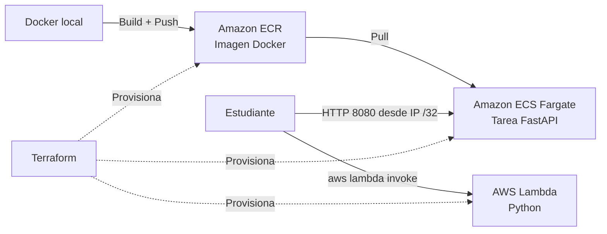

# Diagrama de arquitectura del Laboratorio 04

La tarea ECS usa una subred publica y IP asignada temporalmente para la demostracion. Es un acceso acotado al origen /32 configurado en el Security Group; se eliminara tras validar las evidencias. En el Laboratorio 05 añadiremos un Load Balancer.

## Componentes

| Componente | Rol |
|---|---|
| AWS Lambda | Ejecuta una funcion Python a demanda. |
| Docker | Empaqueta FastAPI en una imagen reproducible. |
| Amazon ECR | Almacena la imagen. |
| ECS Fargate | Ejecuta una tarea que contiene la imagen. |
| Terraform | Define y gestiona la infraestructura de AWS. |
| Security Group | Autoriza acceso de demostracion solo desde una IP. |

