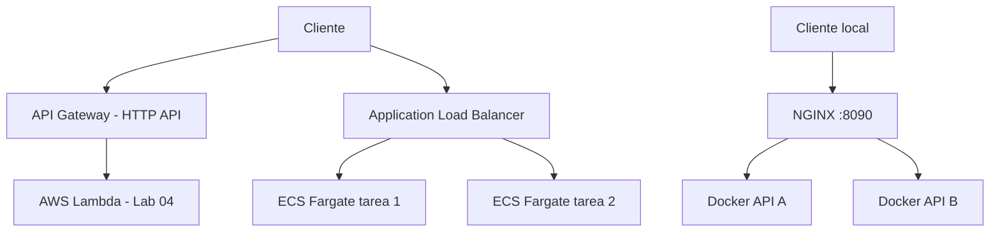

# Laboratorio 05 — Arquitectura

## Justificación
- **API Gateway:** publica la Lambda existente mediante rutas `/` y `/health`.
- **ALB:** recibe HTTP desde un CIDR autorizado y balancea sobre dos tareas ECS, en un Target Group de tipo `ip`.
- **NGINX:** enruta `/a/*` y `/b/*` a servicios Docker distintos, mostrando el encabezado `X-Backend`.

## Seguridad/costos
- Laboratorio de desarrollo: ALB con HTTP en puerto 80; sin datos reales, credenciales ni tráfico sensible.
- ALB solo acepta tráfico desde `allowed_cidr`, y el SG de ECS solo acepta tráfico desde el SG del ALB cuando se habilita la fase B.
- Tareas ECS con IP pública para obtener ECR sin NAT; no son endpoints públicos alcanzables gracias al Security Group. Para producción deben ubicarse en subredes privadas con NAT o VPC endpoints.
- ALB, Fargate e IPs públicas pueden generar cargos hasta que se deshabiliten o destruyan.
