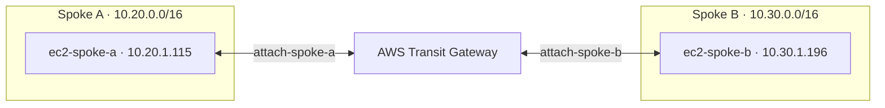
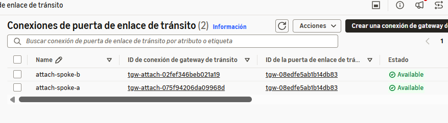
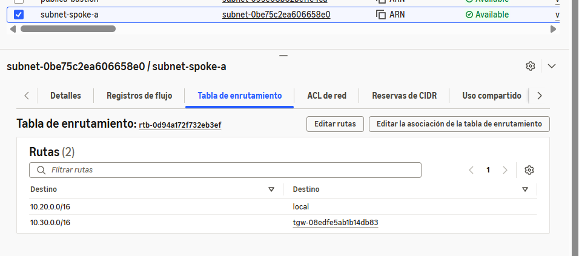
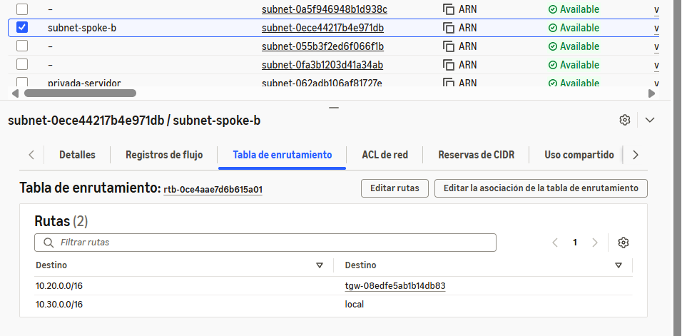
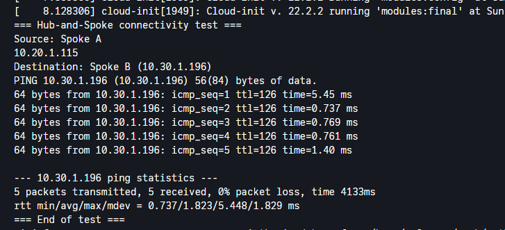

# Lab 06 · Hub-and-Spoke Architecture on AWS

## Objective

Can two servers in different private networks communicate using only their
private IP addresses? This lab demonstrates how to connect them through a
central router called AWS Transit Gateway.

Each network is a **spoke**. The Transit Gateway is the **hub**. When the
server in Spoke A sends a packet to Spoke B, its route table directs the
packet to the hub. The hub forwards it to Spoke B. A return route allows
the reply to reach Spoke A.

## Architecture



| Resource | Spoke A | Spoke B |
|---|---|---|
| Virtual network (VPC) | `vpc-spoke-a` | `vpc-spoke-b` |
| Network address range | `10.20.0.0/16` | `10.30.0.0/16` |
| Test subnet | `10.20.1.0/24` | `10.30.1.0/24` |
| EC2 private IP | `10.20.1.115` | `10.30.1.196` |
| Role in the test | Sends five ping requests | Replies to the requests |

## How the network was configured

### 1. Connect both networks to the hub

We created a Transit Gateway named `tgw-lab-hub` in `us-east-1`.
Each VPC was connected to it through an **attachment**. An attachment
gives the hub a connection to a particular VPC. The hub's route table
learned the address range of each VPC through route propagation.

The screenshot shows both attachments connected to the same gateway.



### 2. Configure a route in each direction

Each subnet uses a route table to decide where to send a packet.
Traffic addressed to the same VPC uses the existing `local` route.
For traffic addressed to the other VPC, we added the following routes:

| Route table | Destination | Target | Purpose |
|---|---|---|---|
| Spoke A | `10.30.0.0/16` | `tgw-08edfe5ab1b14db83` | Send requests to Spoke B |
| Spoke B | `10.20.0.0/16` | `tgw-08edfe5ab1b14db83` | Send replies to Spoke A |

**Spoke A — route to Spoke B**



**Spoke B — return route to Spoke A**



### 3. Allow the connectivity test

We launched one Amazon Linux EC2 instance in each subnet, with public IPv4
assignment disabled. On the receiving instance, the `spoke-b-ping` security
group allowed ICMP echo requests from `10.20.1.0/24`, the subnet of Spoke A.
These are the requests sent by the `ping` command.

## How to reproduce the test

1. Launch the instance in Spoke B first and copy its private IPv4 address.
2. Open [connectivity-test.sh](connectivity-test.sh). If you are recreating
   the lab, replace `10.30.1.196` with your Spoke B address in both the
   destination message and the `ping` command.
3. When launching the instance in Spoke A, paste the script into
   **Advanced details → User data**. The script runs at startup, prints
   the source address and sends five requests to Spoke B.
4. In the EC2 console, select the Spoke A instance and open
   **Actions → Monitor and troubleshoot → Get system log**.
   Search for `Hub-and-Spoke connectivity test` to find the result.

## Observed result

Spoke A (`10.20.1.115`) sent five requests to Spoke B (`10.30.1.196`).
All five received a reply.

```text
5 packets transmitted, 5 received, 0% packet loss, time 4133ms
rtt min/avg/max/mdev = 0.737/1.823/5.448/1.829 ms
```

The average round-trip time was **1.823 ms**. The ping output confirms that
the two instances could communicate in both directions. The route tables
shown above identify the Transit Gateway as the configured path.



## Possible application in AlergoAssist

If AlergoAssist later used separate VPCs for monitoring and application
services, a Transit Gateway could connect them. For example, a monitoring
server in one VPC could check the health of the Appointments service in
another using its private address. The route tables would direct the traffic
through the hub, and the service's security group would allow access only
from the monitoring source on the required port.