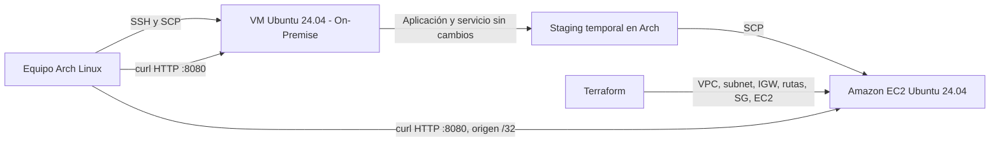

# Arquitectura — Lab07

## Relación con Lift-and-Shift

La práctica mueve **los mismos archivos** de código y configuración del servicio `systemd` desde una VM local a una instancia EC2. Se prueba el mismo endpoint y se compara SHA256 antes y después. La infraestructura se crea con Terraform y la lógica de aplicación no se refactoriza.

Esta es una **simulación de rehosting a nivel de aplicación**, no migración de discos/SO ni replicación continua. Para rehosting de servidores completos AWS ofrece AWS Transform MGN (anteriormente AWS Application Migration Service).

## Seguridad

- Acceso a SSH 22 y HTTP 8080 restringido a `allowed_cidr=/32`.
- Se emplean pares de claves SSH, sin subir claves privadas a GitHub.
- EC2 de laboratorio con IPv4 pública por simplicidad; en producción se usaría una arquitectura privada detrás de balanceador y acceso administrativo sin puertos abiertos.
