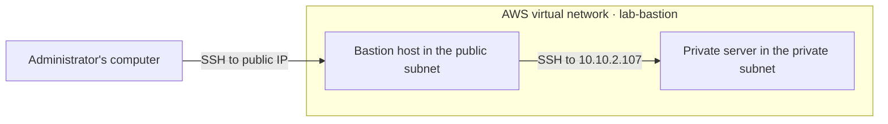
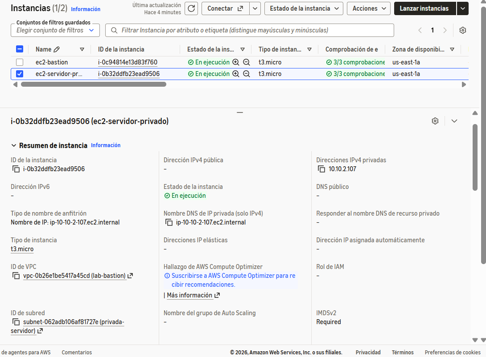
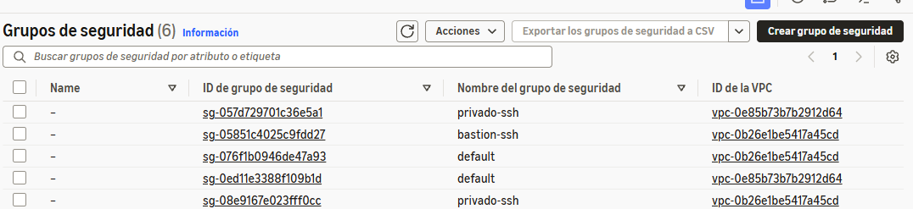
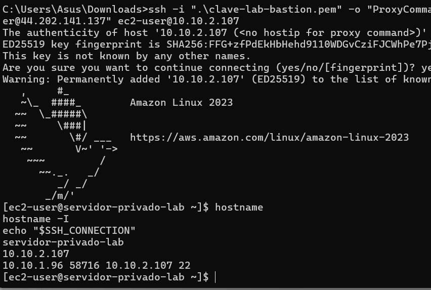

# Bastion Host on AWS

## What does this lab demonstrate?

Imagine an administrator needs to check a server that has no public IP address.
How can the administrator open a terminal on that server from a laptop?

This lab uses a **bastion host** as the entry point. The administrator's
computer connects to the bastion, and the bastion forwards the connection
to the private server. Both connections use **SSH**, a protocol for securely
accessing a remote terminal.

## Architecture



## How the lab was built

1. A virtual network called `lab-bastion` was created in AWS. It contains
   two subnets, one for the entry point and one for the private server.
2. An Amazon Linux EC2 instance named `ec2-bastion` was launched in the
   public subnet. It received a public IP address and the private address
   `10.10.1.96`. Its subnet has a route to an Internet Gateway so the
   administrator can reach it from the internet.
3. A second EC2 instance named `ec2-servidor-privado` was launched in the
   private subnet. Its address is `10.10.2.107`. The screenshot below shows
   a dash in the public IPv4 field because this instance has no public IP.



## Who can connect?

A **security group** controls which connections an EC2 instance accepts.
The lab uses two groups because each server accepts SSH from a different source.

| Instance | Security group | Allowed source for SSH on port 22 |
|---|---|---|
| Bastion host | `bastion-ssh` | The administrator's public IP address |
| Private server | `privado-ssh` | The bastion's security group |

The screenshot below shows the private server's inbound rule. The `sg-...`
value in the source field identifies the bastion's security group.



## How to test the connection

The `ssh-config.example` file tells SSH which computer to connect to first
and which server to reach through it.

1. Open `ssh-config.example` and replace `BASTION_PUBLIC_IP` with the
   current public IPv4 address shown in EC2 for the bastion.
2. Check that `IdentityFile` points to the private key on your own computer.
   The key used in this lab was stored in the Windows Downloads folder.
3. Open a terminal in the folder that contains `ssh-config.example` and run:

```bash
ssh -F ssh-config.example private-server
```

Once connected, run:

```bash
hostname
hostname -I
echo "$SSH_CONNECTION"
```

## Observed result

```text
servidor-privado-lab
10.10.2.107
10.10.1.96 58716 10.10.2.107 22
```

`hostname` identifies the machine where the commands ran. `hostname -I`
shows its private IP address. The last line explains how the connection
arrived: the private server received it from the bastion (`10.10.1.96`)
on SSH port `22`. The number `58716` was the temporary source port for
this session and may change on the next connection.



## Possible use in AlergoAssist

In AlergoAssist, I would place a bastion host in a public AWS subnet and keep the servers that run microservices, such as Appointments and Clinical History, in private subnets. I would configure the bastion to accept SSH connections only from the administrator’s authorized IP address. Each private server would accept SSH connections only from the bastion’s security group.

For example, if staff reported that the appointment calendar was unavailable, the administrator could connect through the bastion to the server running the Appointments service, check whether the service was running, and review its logs. This would allow the administrator to investigate the problem while keeping the server’s administrative port inaccessible directly from the internet.